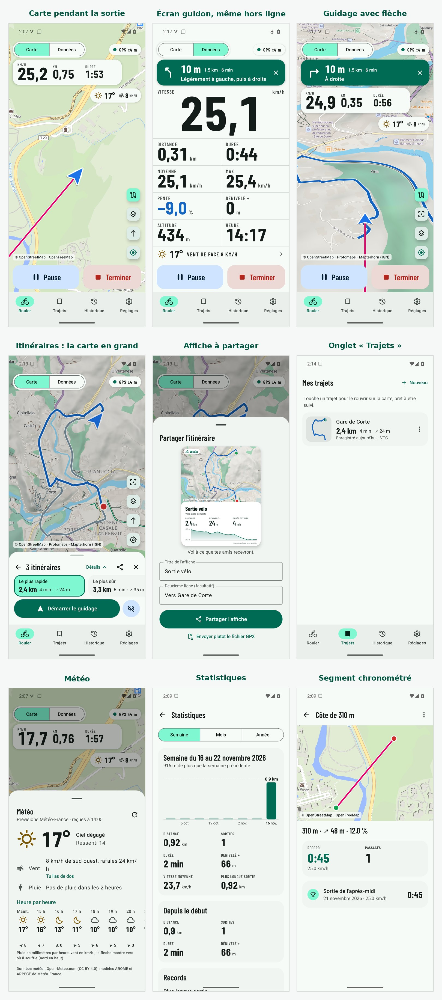

<p align="center">
  
</p>

# VeloGo

Appli Android de vélo pour la France : enregistrement GPS des sorties, itinéraires vélo et
guidage, cartes hors ligne, météo et statistiques. Gratuite, sans compte, sans publicité ; les données restent sur
le téléphone.

Créé par **Paul-Louis Ramphort**.

**[Télécharger la dernière version](https://github.com/ramphortpl/velo/releases/latest)** ·
[Nouveautés de chaque version](docs/NOUVEAUTES.md)



*Vrais écrans de l'appli, pris pendant l'essai automatique de la version 0.7 sur un émulateur Android 15 (sortie
simulée à Corte).*

## Ce que fait l'appli

- **Rouler** : trace GPS en direct sur la carte, écran « guidon » en très gros chiffres (vitesse, distance, durée,
  moyenne, max, pente, dénivelé, altitude), pause automatique, enregistrement écran éteint. La musique n'est
  jamais coupée.
- **Cartes** : plusieurs fonds en ligne (plan, CyclOSM, Plan IGN, photos aériennes) et une carte vélo **hors ligne**
  par région (pistes, voies vertes, véloroutes, relief), en clair ou en sombre.
- **Itinéraires** : calculés sur le téléphone, même sans réseau : le plus rapide, le plus sûr, le moins de dénivelé,
  pour vélo de route, VTC/gravel ou VTT. La carte se cadre en grand sur le trajet ; un appui sur un tracé le choisit.
- **Guidage** comme sur un GPS de voiture : ta position est une flèche qui montre ton sens de marche, la carte
  tourne avec toi et les consignes s'affichent en grand, avec alerte et recalcul si tu t'écartes. Voix en option.
- **Partager** : une affiche de l'itinéraire (carte, distance, dénivelé, durée, profil) à envoyer par WhatsApp, SMS,
  e-mail…, ou le fichier GPX. L'appli sait aussi suivre un fichier GPX reçu.
- **Trajets** : tes itinéraires enregistrés dans leur onglet, à rouvrir d'un appui, même sans réseau.
- **Météo** : prévisions Météo-France (via Open-Meteo), pluie au quart d'heure, vent de face ou de dos, météo le
  long de l'itinéraire à l'heure de passage, alerte pluie pendant la sortie.
- **Historique** : chaque sortie avec sa carte, ses chiffres et ses graphiques ; totaux par semaine, mois et
  année ; records ; meilleurs temps ; segments personnels chronométrés ; sauvegarde et import en GPX.

## Installer ou mettre à jour

Il faut un téléphone Android 8 ou plus récent, à processeur 64 bits (ARM64). L'appli a été mise au point pour un
Samsung Galaxy A05s sous Android 15.

1. Sur le téléphone, ouvre la [dernière version](https://github.com/ramphortpl/velo/releases/latest).
2. Sous « Assets », touche le fichier `VeloGo-x.y.z.apk` pour le télécharger (16 Mo environ).
3. Ouvre-le et accepte l'installation (la première fois, Android demande d'autoriser le navigateur à installer
   des applis).

Chaque version s'installe par-dessus la précédente sans rien effacer : elles sont toutes signées avec la même clé.
L'appli signale d'elle-même quand une version plus récente est disponible (Réglages).

Si le téléphone refuse l'installation :

- **Samsung** : le « Bloqueur automatique » interdit les applis qui ne viennent pas d'un magasin d'applis. Dans les
  paramètres du téléphone, **Sécurité et confidentialité > Bloqueur automatique** : désactive-le le temps
  d'installer (ou de mettre à jour) VeloGo, puis réactive-le si tu veux.
- **Google Play Protect** peut proposer d'analyser l'appli, qu'il ne connaît pas puisqu'elle ne vient pas du
  Play Store : tu peux accepter l'analyse, puis poursuivre l'installation.

## Premiers pas dans l'appli

1. Autorise la position, puis touche **Démarrer** : l'écran « guidon » s'affiche, la carte reste à un geste.
2. **Réglages > Cartes hors ligne** : télécharge ta région en Wi-Fi (de 86 Mo pour la Corse à plus d'un Go pour
   les plus grandes). Elle apporte la carte vélo, le relief (altitude et pente précises) et les données
   d'itinéraire.
3. Sur la carte, le bouton **Itinéraire** : cherche une adresse ou fais un appui long sur la carte. Les
   propositions s'affichent sur la carte en grand ; « Détails » montre le profil et la nature des voies.
4. **Démarrer le guidage** : la flèche montre ton sens de marche et la carte tourne avec toi. Si tu déplaces la
   carte, « Recentrer » y ramène.
5. Pour garder un itinéraire : « Détails », puis « Enregistrer cet itinéraire ». Tu le retrouves dans l'onglet
   **Trajets**. Le bouton de partage du panneau prépare l'affiche à envoyer à tes amis.
6. Sur un Samsung, suis **Réglages > Fiabilité de l'enregistrement** pour que l'appli ne soit pas mise en veille
   écran éteint.

## Bon à savoir

- **France uniquement** : la carte est bornée à la France et l'interface est en français.
- **Sans boussole** (le Galaxy A05s n'en a pas), la flèche suit ton déplacement : à l'arrêt elle garde ta dernière
  direction, et il faut rouler quelques mètres pour qu'elle s'oriente.
- **Sans baromètre**, l'altitude vient du GPS et du relief des cartes ; à la fin d'une sortie elle est recalée sur
  le relief (celui de l'IGN si le réseau répond, sinon celui des cartes hors ligne).
- Les consignes de guidage ne donnent pas les noms de rue : les données d'itinéraire n'en contiennent pas.
- Un trajet enregistré se suit tel quel, avec ses consignes : si tu t'en écartes, l'appli te prévient sans le
  recalculer.
- L'affiche a besoin du réseau pour son fond de carte, sauf si le fond choisi est la carte « Vélo hors ligne » ;
  sans lui, elle montre le tracé seul.
- La sauvegarde (une archive ZIP de fichiers GPX) contient les sorties, pas les segments ni les trajets
  enregistrés.
- Sur un téléphone, l'appli s'utilise en portrait ; sur une tablette ou un téléphone déplié, elle suit l'écran.

## Tes données

Tes sorties, tes trajets et tes réglages ne sont enregistrés que sur le téléphone : pas de compte, pas de
publicité, pas de mesure d'audience, aucun serveur propre à l'appli. Pour fonctionner, elle interroge tout de même
quelques services publics, sans compte ni identifiant :

| Pour | À qui | Ce qui est envoyé |
|---|---|---|
| Les fonds de carte en ligne | OpenFreeMap, OpenStreetMap France (CyclOSM), IGN | la zone de carte affichée |
| La recherche d'adresses | IGN (Géoplateforme) | le texte cherché et ta position (pour proposer d'abord les lieux proches) ; le point que tu touches sur la carte, pour lui donner un nom |
| Le recalage de l'altitude en fin de sortie (désactivable) | IGN (Géoplateforme) | les positions de la trace |
| La météo (désactivable) | Open-Meteo | ta position et, pour un itinéraire, quelques points du trajet, arrondis à un kilomètre environ |
| Les mises à jour et les cartes hors ligne | GitHub | rien de personnel |

Avec les cartes hors ligne de ta région, la carte, les itinéraires, le guidage et l'altitude fonctionnent sans
aucun réseau ; seule la recherche d'adresses en a besoin (un appui long sur la carte la remplace).

Le détail est dans la [politique de confidentialité](docs/CONFIDENTIALITE.md), que l'appli affiche aussi
(Réglages > Confidentialité).

## Google Play

Chaque version publiée contient aussi un fichier `VeloGo-x.y.z-play.aab` : la même appli, signée de la même clé,
au format que demande le Play Store. Elle se distingue de l'APK sur deux points imposés par les règles du
magasin : elle ne cherche pas ses mises à jour sur GitHub, et elle ne demande pas directement à Android de ne pas
la mettre en veille (elle ouvre la fiche de l'appli dans les réglages du téléphone).

Le [guide de publication](docs/PLAY_STORE.md) dit ce qu'il reste à faire côté Google (compte développeur à 25 $,
test fermé, formulaires) et donne les réponses toutes prêtes ; les textes de la fiche sont dans
[docs/play/fiche.md](docs/play/fiche.md), ses images dans le même dossier.

## Fabrication et publication

Tout est automatique et gratuit, sur GitHub :

- À chaque modification du code, le workflow **APK VeloGo** lance les tests, fabrique l'APK signé et le fichier
  pour Google Play, puis déroule un essai complet sur un émulateur Android 15 (sortie simulée, cartes hors ligne,
  itinéraire, guidage, mode avion, version Play installée par-dessus…). La version n'est publiée dans les
  [Releases](https://github.com/ramphortpl/velo/releases) que si tout a réussi, une vingtaine de minutes plus tard.
- La signature a besoin du secret `VELOGO_KEYSTORE_PASSWORD` (**Settings > Secrets and variables > Actions**) : le
  mot de passe de la clé de signature, qui n'est écrit nulle part dans le dépôt. Tant qu'il manque, les tests
  tournent mais aucun APK n'est publié ; s'il est faux, le workflow le dit dès ses premières secondes (le bon mot
  de passe fait 40 caractères, lettres et chiffres uniquement).
- Les cartes hors ligne sont fabriquées par le workflow **Cartes hors ligne** et publiées dans la Release `cartes`.
  Elles sont refaites automatiquement le 4 de chaque mois, avec les données OpenStreetMap du moment.

## Développement

Kotlin et Jetpack Compose, carte MapLibre, itinéraires BRouter embarqués, base Room ; quatre modules (`core` pour
les calculs, `brouter`, `routing`, `app`). L'architecture, les décisions et les commandes sont dans
[CLAUDE.md](CLAUDE.md).

```bash
./gradlew test                       # tous les tests
./gradlew :app:assembleGithubDebug   # APK de test
```

L'image d'aperçu de cette page se refait à partir des captures de l'essai sur émulateur :
`python3 outils/apercu_readme.py dossier_des_captures docs/apercu.jpg`. Le logo (dossier `docs/logo/`) et tout ce
qui en découle dans l'appli (icône, écran de démarrage, notification, affiche) se refont avec
`python3 outils/logo.py`.

## Licences et données

Le code de l'appli n'est placé sous aucune licence libre pour l'instant : il reste la propriété de son auteur.
Données cartographiques © les contributeurs d'OpenStreetMap (ODbL) ; fonds,
adresses et altitudes de l'IGN (Géoplateforme, Licence Ouverte 2.0) ; météo Open-Meteo (CC BY 4.0), modèles
Météo-France ; fond hors ligne Protomaps ; relief Mapterhorn ; itinéraires BRouter (MIT). Le détail des
attributions est dans l'appli (Réglages > Sources et licences).
